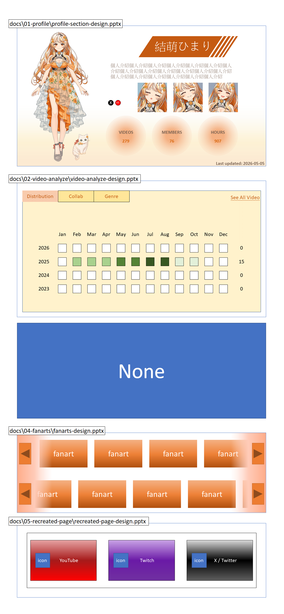

# Docs Index

This folder contains the design docs, data notes, and wireframes for this project.

Read [Product Design](00-overview/product-design.md) first for the overall direction, then open a block folder when you need the details of a specific section.

## Quick Links

| Docs | Description |
| --- | --- |
| [Product Design](00-overview/product-design.md) | Overall product direction, page structure, and shared block rules. |
| [Profile Docs](01-profile/README.md) | First-view identity area with the main visual, short profile, official links, and archive stats. |
| Video Analyze Docs (Preparing...) | Activity analysis with stream charts, collaboration analysis, and the full video archive. |
| [X Tag Searcher Docs](03-tag-searcher/README.md) | Prepared tags that open X / Twitter search results. |
| Fanarts Docs (Preparing...) | Horizontal fanart carousel with auto-scroll and direction controls. |
| Recreated Pages Docs (Preparing...) | Preserved historical pages such as Litlink, YouTube, Twitch, and Twitter. |
| [GitHub Pages](https://hsiao93524.github.io/vite-vtb-himari-profile/) | Live site (public version). |

## Overall Framework Preview

